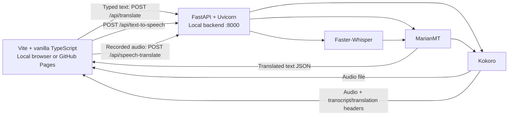

<div align="center">

# VaaniPlus

### Speech translation and transcription for English and Hindi

### Translate speech. Preserve meaning. Keep it local.

<p>


</p>
<p>


</p>
<p>

</p>
<p>
<strong>Speech-to-text runtime</strong><br>
<a href="https://github.com/SYSTRAN/faster-whisper">SYSTRAN/faster-whisper</a>
</p>
<p>
<strong>Hugging Face models</strong><br>
Speech-to-text:
<a href="https://huggingface.co/Systran/faster-whisper-small">Systran/faster-whisper-small</a><br>
Translation EN → HI:
<a href="https://huggingface.co/Helsinki-NLP/opus-mt-en-hi">Helsinki-NLP/opus-mt-en-hi</a><br>
Translation HI → EN:
<a href="https://huggingface.co/Helsinki-NLP/opus-mt-hi-en">Helsinki-NLP/opus-mt-hi-en</a><br>
Text-to-speech (English and Hindi):
<a href="https://huggingface.co/hexgrad/Kokoro-82M">hexgrad/Kokoro-82M</a>
</p>

VaaniPlus is a local-first browser application for English ↔ Hindi speech
translation and transcription. Its pipeline is **speech-to-text → text
translation → text-to-speech**. The Vite + vanilla TypeScript frontend provides
microphone capture, typed-text input, result display, and audio playback. The
FastAPI backend coordinates replaceable Faster-Whisper, MarianMT, and Kokoro
providers.

The backend also provides small local account authentication backed by
PostgreSQL in Docker. Speech routes remain available without a token for the
existing local demo.

[Overview](#scope) · [User guide](frontend/README.md) · [Architecture](#architecture) · [Setup](#getting-started) · [API docs](docs/api.md) · [Final demo](docs/final-demo-script.md) · [Handoff](docs/final-handoff.md)

</div>

---

### Faster-Whisper on Windows

Speech-to-text uses the
[SYSTRAN faster-whisper project](https://github.com/SYSTRAN/faster-whisper)
with the Hugging Face model
[Systran/faster-whisper-small](https://huggingface.co/Systran/faster-whisper-small).
For GPU-accelerated transcription on Windows, the requirements are:

- an NVIDIA GPU with CUDA support; and
- [cuDNN 9.x](https://developer.nvidia.com/cudnn) installed on Windows.

Faster-Whisper runs through CTranslate2, so the installed NVIDIA driver and
CUDA/cuDNN libraries must be compatible with the installed CTranslate2 version.
**This project uses CPU inference, not GPU acceleration**
(`DEVICE=cpu`, `STT_COMPUTE_TYPE=int8`).
To opt into GPU inference, configure a compatible CUDA setup. If CUDA is
unavailable or fails, use the CPU settings above. See the
[Windows setup guide](docs/windows-setup.md) for configuration and diagnostics.

## Scope

This project intentionally supports English and Hindi only. It does not
include other languages, multi-party calls, cloud
deployment, or voice cloning. Audio and text are intended to stay local;
do not send them to external services unless the team explicitly documents
and approves that integration.

## Project structure

```text
.
├── backend/
│   ├── app/
│   │   ├── api/          # FastAPI routes
│   │   ├── core/         # Configuration and logging
│   │   ├── providers/    # Faster-Whisper, MarianMT, Kokoro
│   │   ├── schemas/      # Request and response models
│   │   ├── services/     # Speech, translation, and synthesis workflows
│   │   ├── utils/
│   │   └── main.py
│   ├── tests/
│   ├── pyproject.toml
│   └── uv.lock
├── frontend/
│   ├── src/main.ts       # Vanilla TypeScript UI behavior
│   ├── index.html
│   ├── styles.css
│   ├── package.json
│   └── vite.config.ts
├── data/                 # Evaluation datasets
├── docs/                 # Architecture, API, setup, and demo guides
└── README.md
```

See the [backend setup](backend/README.md), [frontend setup](frontend/README.md),
[requirements](docs/requirements.md), and
[architecture guide](docs/architecture.md) for details.

## Architecture



Typed input is translated first, then the frontend requests speech for the
translated text. Recorded speech follows the backend pipeline:
**speech-to-text → text translation → text-to-speech**. In mock mode, fake
providers demonstrate the workflow; real mode uses the local model providers.
GitHub Pages hosts only the static frontend; a separately hosted backend is
required for API features outside local development. See the full
[architecture guide](docs/architecture.md).

## Getting started

Start the backend and frontend in two separate PowerShell terminals from the
repository root. `uv run` prepares the backend environment automatically. On
the first frontend run, install its dependencies once with `npm ci`. Start
PostgreSQL first:

```powershell
docker compose up -d postgres
```

The Compose service uses the official Docker image tag `postgres:16`.

The local demo account is created automatically the first time an auth endpoint
is used:

- Email: `proindra@example.com`
- Password: `VaaniProindra#2026`

These are development-only credentials. Set `DEFAULT_USER_EMAIL` and
`DEFAULT_USER_PASSWORD` in `backend/.env` before using this setup beyond a
local demo.

### Terminal 1 — Backend

```powershell
uv run --project backend --directory backend uvicorn app.main:app --host 127.0.0.1 --port 8000 --reload
```

### Terminal 2 — Frontend

```powershell
Set-Location .\frontend
# First run only:
npm ci
npm run dev
```

Open <http://127.0.0.1:5173>. The frontend communicates with the API through
Vite's `/api` proxy. For optional real-model configuration and troubleshooting,
see the [Windows setup guide](docs/windows-setup.md).

## GitHub Pages

The GitHub Actions workflow publishes only the static frontend to
<https://vaaniplus.github.io/speech-to-speech-translation-and-transcription/>.
The backend is not deployed by this workflow, so translation, transcription,
and speech synthesis require a separately hosted API; the Vite API proxy works
only during local development.

### Translation modes

Without a local `.env`, the backend uses mock providers; mock results are
placeholders, not real translations or speech. To enable local model inference,
copy the example configuration and install the optional model dependencies
once:

```powershell
Copy-Item backend/.env.example backend/.env
uv sync --project backend --extra ml
```

The example selects real providers and **MarianMT** for typed English ↔ Hindi
translation. Its model downloads on the first translation request. See the
[translation model guide](docs/translation-model-selection.md) for model and
Windows notes.

### Run tests

```powershell
uv run --project backend pytest
```

The default suite uses fake providers and does not download model weights. See
[testing](docs/testing.md) for the focused speech integration test and
[optional real-model smoke test](docs/model-smoke-test.md).

### Latest local validation (2026-11-18)

- `uv run --project backend pytest`: 125 passed, 1 skipped. The skip is the
  optional real Faster-Whisper test, which needs model inference and a recording.
- A real MarianMT API request returned Hindi, and Kokoro generated a valid Hindi
  WAV file.
- Mock providers remain workflow placeholders. Physical microphone capture and
  real STT inference were not validated in this run.

This smoke check is not a translation-quality benchmark. See the
[demo checklist](docs/demo-checklist.md) for workflow validation.

## Project workflow

Contributors should work on one short-lived branch per Scrum item, based on
the latest `main`, and open a pull request for each completed item. Never
commit or push directly to shared `main`, and never force-push it. Rebase a
feature branch before publishing if `main` has moved; use GitHub's **Squash and
merge** option to avoid merge commits. A different team member should review
the pull request and approve it before it is merged.

```powershell
git switch main
git pull --ff-only origin main
git switch -c feature/AMTT-<number>-short-description
# Make and test the change, then commit only the relevant files.
git push -u origin feature/AMTT-<number>-short-description
```

Replace the example branch name with the task's Jira key and a short
description. Use the pull request checklist in
[`.github/PULL_REQUEST_TEMPLATE.md`](.github/PULL_REQUEST_TEMPLATE.md).
Repository administrators should protect `main` by requiring an approving
review and preventing force pushes and branch deletion. This repository's
branch protection must be enabled in GitHub settings by an administrator.
